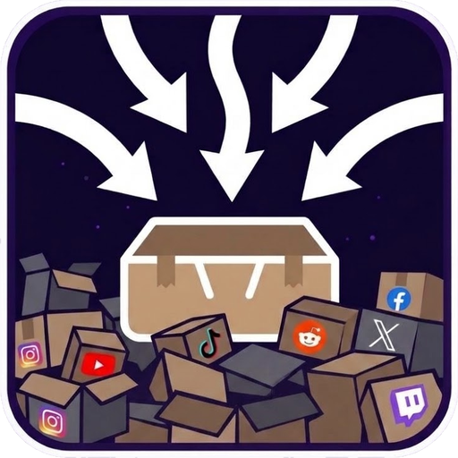
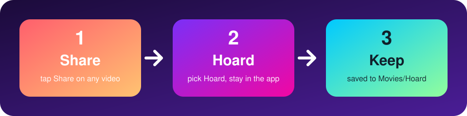
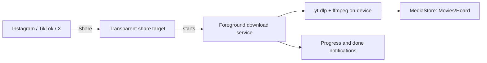

<p align="center">
  
</p>

<h1 align="center">Hoard</h1>

<p align="center">
  <b>Tap Share. Pick Hoard. Keep the video.</b><br>
  Save videos from Instagram, TikTok, X and 1000+ other sites, right from the share sheet, without ever leaving the app you're in.
</p>

<p align="center">
  <a href="../../releases/latest"></a>
  
  
  
  <a href="LICENSE"></a>
  <a href="../../stargazers"></a>
</p>

<p align="center">
  
</p>

## ✨ Why Hoard

You find a video you love, and a week later it's gone, deleted, private or buried. Hoard saves it in
two taps. No copy-pasting links into sketchy websites, no ads, no accounts, no servers.

| | |
|---|---|
| 🚀 **Stay where you are** | The share target is a transparent native screen that closes instantly, so you never leave Instagram or TikTok. |
| 🔔 **Live notifications** | A heads-up when the download starts, a quiet progress bar with thumbnail, file name and uploader, and another heads-up with **Open** and **Share** when it's done. |
| 🎬 **Real gallery files** | Videos land in `Movies/Hoard/` and show up in your gallery. No storage permission needed. |
| 🌍 **Works nearly everywhere** | Powered by [yt-dlp](https://github.com/yt-dlp/yt-dlp), which knows over a thousand sites. Links it can't handle get a clear "Unsupported link" notice. |
| 🔐 **Optional login** | Log in to Instagram or TikTok inside the app for content that needs an account. Cookies are encrypted with the Android Keystore and never leave your phone. |
| 📚 **Library and player** | Browse everything you've saved in a grid, then swipe through it in a built-in vertical player. |
| 📋 **Paste or auto-detect** | Paste a link into the app, or tap the banner when Hoard spots a link you just copied. |
| 🔄 **Self-updating** | yt-dlp refreshes itself in the background so downloads keep working when sites change. |
| 🕵️ **No backend, no tracking** | Everything runs on your device with your own connection. |

## 🌐 Tested and ready

<p>
  
  
  
  
  
  
  
  
  
</p>

Instagram, TikTok and X are tested on a real phone. The rest, plus Threads, Snapchat, Tumblr, Dailymotion,
Bluesky and Streamable, are wired up and depend on what yt-dlp supports at the time.

## 📲 Install

1. Download **`Hoard-v1.0.0-arm64-v8a.apk`** from the [latest release](../../releases/latest). It works on almost every current phone.
2. Open it and allow installs from your browser or file manager when Android asks.
3. Play Protect may warn about an unknown app. That's because Hoard isn't on Google Play, and you can install anyway.
4. Open Hoard once and allow notifications.

Then open any video in Instagram, TikTok, X and so on, tap **Share → Hoard**, and you're done.

> **Tip, Android 12+:** official apps beat Hoard when you tap a link. If you want links to open in Hoard,
> use **Settings → Links** inside Hoard for a shortcut to each app's "Open supported links" switch.
> Sharing and pasting always work without this.

## 🧠 How it works



- **Flutter** draws the app: library, player, accounts, settings.
- **Native Kotlin** handles everything on the share path, so no Flutter engine has to start while you're in another app.
- **[youtubedl-android](https://github.com/JunkFood02/youtubedl-android)** bundles yt-dlp and ffmpeg.
- Two downloads run at once and the rest queue up.

## 🛠️ Build it yourself

You need Flutter (stable) and the Android SDK.

```bash
git clone https://github.com/Md-nexus/Hoard.git
cd Hoard
flutter pub get
flutter analyze
flutter build apk --release --split-per-abi
```

APKs land in `build/app/outputs/flutter-apk/`. Pick `app-arm64-v8a-release.apk` for most phones.

## ❓ FAQ

<details>
<summary><b>Why isn't it on the Play Store?</b></summary>
Downloader apps aren't allowed there. Hoard ships as a direct APK through GitHub Releases.
</details>

<details>
<summary><b>Do I need to log in?</b></summary>
No. Public videos download without an account. Instagram often asks for a login or rate-limits anonymous
requests, so there's an optional in-app login for Instagram and TikTok. If you use it, consider a secondary
account, since platforms can flag automated access.
</details>

<details>
<summary><b>Where are my videos?</b></summary>
In your gallery under the <b>Hoard</b> album (<code>Movies/Hoard/</code>), and in the app's Library tab.
</details>

<details>
<summary><b>A download failed. What now?</b></summary>
Sites change often, and Hoard updates yt-dlp itself at most once a day. You can also tap
<b>Update yt-dlp</b> in Settings. If it still fails, please
<a href="../../issues/new">open an issue</a> with the link type and the error shown.
</details>

<details>
<summary><b>Is my login safe?</b></summary>
Cookies are stored encrypted with the Android Keystore in the app's private storage. Hoard has no server,
so nothing is sent anywhere except to the site you're downloading from.
</details>

## 🗺️ Roadmap

- [x] Share-sheet downloads with live notifications
- [x] Library and in-app player
- [x] Optional Instagram and TikTok login
- [ ] Live queue status in the app
- [ ] Queue that survives the app being killed
- [ ] Smarter retry for rate limits and no-network failures
- [ ] Signed release builds

Ideas and bug reports are welcome in [Issues](../../issues).

## ⭐ Like it?

If Hoard saved you a video you thought you'd lost, **[give it a star](../../stargazers)**. It's the easiest way
to help other people find it.

## 🙏 Credits

Built on the shoulders of [yt-dlp](https://github.com/yt-dlp/yt-dlp),
[youtubedl-android](https://github.com/JunkFood02/youtubedl-android), [FFmpeg](https://ffmpeg.org) and
[Flutter](https://flutter.dev). Inspired by Quick Insta.

## 📄 License

[MIT](LICENSE). Hoard is not affiliated with Instagram, TikTok, X or any other platform.

## ⚠️ Disclaimer

For personal use, rewatching and not losing content you care about. Respect creators and each
platform's terms.
